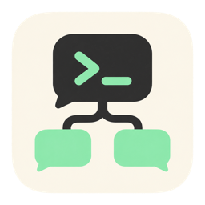
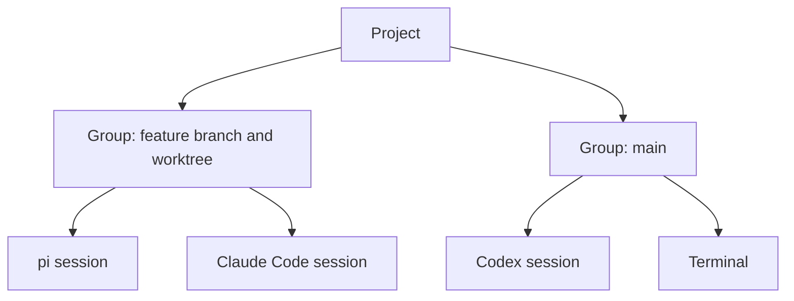

  

<h1 align="center">DevOS</h1>

  A macOS terminal where every CLI agent session is a persistent node in a project tree. 
  Close it, reopen it, and the conversation picks up where it left off.

  <a href="https://github.com/DanieleRiccelli/devos-releases/releases/latest"><strong>Download the latest release</strong></a>

---

This repository hosts DevOS's installers and its update feed. The source code is private.

## Why DevOS

Coding agents usually run in a generic terminal, which has no idea what it is hosting. DevOS keeps the shell and organises it around the agents:

- **Conversations have a place.** Each agent session is a node in the tree. Reopen the node and the conversation resumes, with no resume flag or id to remember.
- **You can see what agents are doing.** Working, waiting for an answer or finished are reported by the agents themselves, not guessed from the screen.
- **Tabs behave like a browser's.** Switching tab closes nothing: the process keeps running and its output keeps arriving.
- **The work stays together.** Repository, branch, worktree, changed files and the agent changing them sit in one window.

## Install

You need a Mac with macOS 14 or later, Apple Silicon or Intel. The same DMG works on both.

1. Download the DMG from the [latest release](https://github.com/DanieleRiccelli/devos-releases/releases/latest).
2. Open it and drag **DevOS** into **Applications**.
3. Open DevOS. macOS blocks the first launch, because the app is self-signed rather than signed with an Apple Developer ID.
4. Go to **System Settings → Privacy & Security → Open Anyway** and confirm.

Agents are installed separately. DevOS works with [pi](https://pi.dev), Claude Code, Codex and Antigravity, using the CLIs and accounts you already have. Without any of them, it still opens terminals.

## Getting started

1. **Create a project.** Choose *New project*, give it a name and a default folder in the settings panel.
2. **Start a session.** Open an agent or a terminal in the project. It appears as a node in the sidebar tree.
3. **Work in parallel.** Open more sessions in the same tab, arrange them in panes, and drag panes to rearrange them. Group sessions by feature, optionally on their own git worktree.
4. **Close and come back.** Reopen a closed agent session from the tree and the conversation resumes. For a new conversation, create a new session.

## What's inside

| Feature | What it does |
| --- | --- |
| **Terminal** | Terminals built on libghostty and drawn with Metal |
| **Code and Chat** | Switch a session between its terminal view and a chat view with rendered Markdown, tool cards and diffs |
| **Agent messaging** | Sessions launched together can send each other tasks with `/devos:send` and name themselves with `/devos:rename` |
| **Files** | Editor with syntax highlighting, find and replace, and previews for Markdown, HTML, tables and JSON |
| **Git** | Hunk staging, commit graph, changes tree and worktrees |
| **Browser** | WebKit pane with phone and tablet views, which the tab's agents can drive |
| **Simulator** | Show and control iOS simulators, Android emulators and phones. Needs Xcode for iOS and the Android SDK tools for Android |
| **Canvas** | A board with flowcharts that you and the tab's agents can draw on |
| **Subscriptions** | Usage limits of your agent accounts in the status bar |
| **Command line** | **Settings → Command line → Install** adds a `devos` command that opens a folder as a project |

## Updates

DevOS checks for a new version when it opens, and when you press **Settings → General → Check for updates**. It never checks on a schedule.

Nothing is downloaded or installed without asking. Installing restarts DevOS, which ends running terminals and agents, so the confirmation says how many sessions will close. Open panels close too, and unsaved changes in them are lost.

> Coming from 0.8: close Settings and any other panel before confirming the update, or press ⌘Q if the installing panel stays on screen. 0.7 and earlier have no updater: install the latest DMG by hand.

## Your data

Settings, sessions and history stay on your Mac, in `~/Library/Application Support/it.nextadv.devos`, and survive updates. DevOS itself does not need an account. Your agents and the update check use the network.

To uninstall, quit DevOS and delete it from **Applications**. Delete the folder above to remove your data too.

## Limitations

- The app is not notarized, so each new install needs the **Open Anyway** step.
- Not included: remote access, global search, system notifications.
